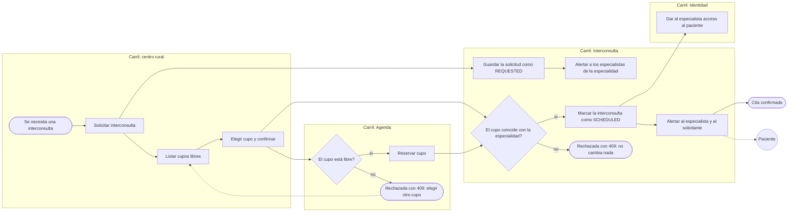
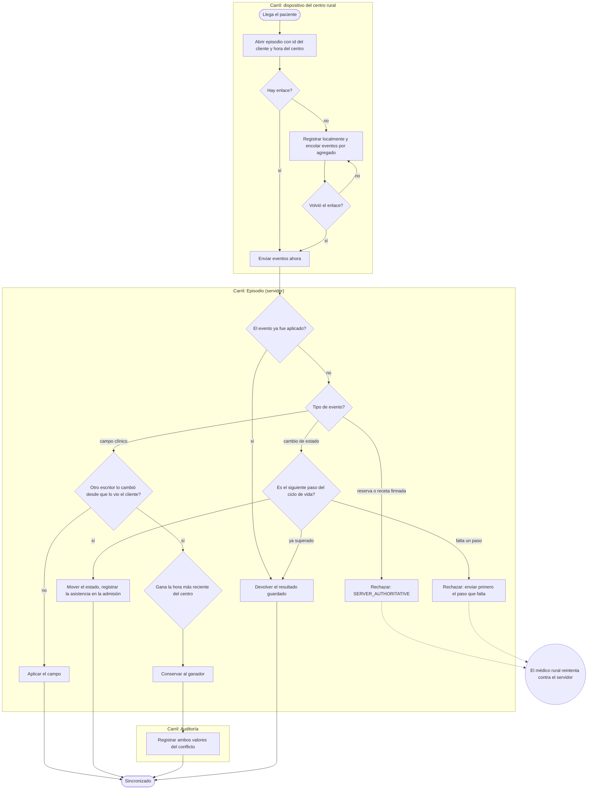
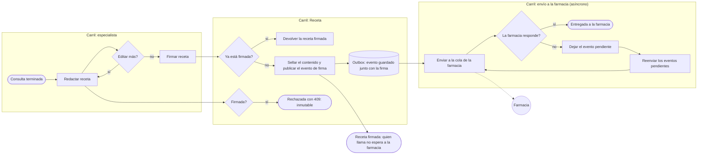
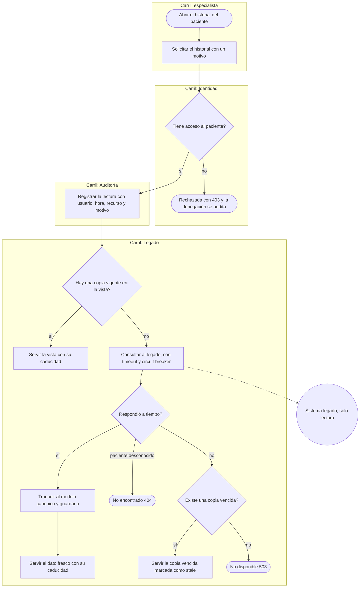

# Vistas BPMN de RedSalud Andina

Cuatro procesos de negocio, tal como corren en el código. Mermaid no tiene notación BPMN, así que las formas se corresponden así:
un subgrafo es un carril o pool, `{...}` es un gateway, `([...])` es un evento, `[[...]]` es la llamada a un subproceso,
`[...]` es una tarea y una flecha punteada es un mensaje hacia o desde un actor externo.

Regla de oro del taller: toda tarea indica el contexto delimitado que la ejecuta, el dato que produce y el evento que emite.
Los contextos son los ocho del mapa de datos: Identidad, Agenda, Episodio, Receta, Interconsulta, Legado, Auditoría, Analítica.
Las tareas que llaman a una API o escriben en una tabla son aquí tareas de negocio, no implementación.

Actores externos: el **centro rural** (médico rural y su dispositivo), el **especialista**, el **paciente**, la
**farmacia** y el **sistema legado** (solo lectura, nunca se modifica).

## 1. Agendar una teleconsulta

El gateway "el cupo está libre" es el invariante: la restricción única sobre la reserva decide cuando dos centros confirman
a la vez, y el perdedor recibe un conflicto. Reservar y "marcar SCHEDULED" son una sola transacción, así que un fallo en
cualquiera de las dos deja ambas sin cambios.

| Tarea | Contexto | Dato que produce | Evento que emite | Camino de excepción |
|---|---|---|---|---|
| Solicitar interconsulta | Interconsulta | Consulta en REQUESTED | `ConsultStatusChanged` (null -> REQUESTED) | Sin acceso al paciente: 403 y un registro de auditoría ACCESS_DENIED |
| Alertar a los especialistas de la especialidad | Interconsulta | Alerta dirigida a la especialidad | ninguno (se guarda en la misma transacción) | ninguno |
| Listar cupos libres | Agenda | Lista de cupos libres | ninguno | Nada libre: lista vacía |
| Reservar cupo | Agenda | Reserva | `SlotBooked` | Cupo tomado: 409, no cambia nada |
| Marcar la interconsulta como SCHEDULED | Interconsulta | Estado, id de reserva, id de especialista | `ConsultStatusChanged` (REQUESTED -> SCHEDULED) | Especialidad equivocada o transición inválida: 409 y la reserva se revierte |
| Dar al especialista acceso al paciente | Identidad | Relación de cuidado | ninguno | ninguno |
| Alertar al especialista y al solicitante | Interconsulta | Dos alertas | ninguno | ninguno |

## 2. Atender y registrar (con y sin conectividad)

Ciclo de vida del episodio: WAITING (sala de espera) -> ADMITTED (admisión, asistencia registrada) -> IN_PROGRESS ->
COMPLETED. Objetivos: sincronización dentro de los 15 minutos siguientes a la reconexión y cero pérdida; la cola conserva cada
evento hasta que el servidor lo ha aplicado.

| Tarea | Contexto | Dato que produce | Evento que emite | Camino de excepción |
|---|---|---|---|---|
| Abrir episodio | Episodio | Episodio en WAITING; relación de cuidado para el médico | `EpisodeOpened` | Id ya usado para otro paciente: rechazado |
| Registrar la asistencia en la admisión | Episodio | Estado ADMITTED y hora de admisión | ninguno | Falta un paso: rechazado, agregado bloqueado |
| Registrar campo clínico | Episodio | Valor del campo con hora del centro (motivo, notas, diagnóstico, nota de evolución, signos vitales) | ninguno | Campo desconocido o demasiado largo: rechazado |
| Adjuntar examen | Episodio | Metadatos del adjunto; los bytes van al almacenamiento de objetos | ninguno | Id de adjunto usado en otro episodio: 409 |
| Aplicar lote de eventos | Episodio | Registro de evento aplicado, resultado por evento | ninguno (una métrica contador) | Reserva o receta firmada: rechazada para reintentar contra el servidor |
| Registrar ambos valores de un conflicto | Auditoría | Registro de auditoría FIELD_CONFLICT (valor conservado y descartado) | ninguno | ninguno |
| Leer episodio | Episodio | Vista del episodio | `ClinicalRecordRead` (a través de la tarea de auditoría) | Sin acceso o sin motivo: 403 o 400 |

## 3. Recetar y enviar a la farmacia

La firma es una compuerta dura: no existe camino de un borrador a la farmacia que se la salte. Firmar es una tarea de usuario (la
llama un especialista), no una tarea de servicio. El envío es un evento asíncrono desde el outbox, nunca una llamada bloqueante.

| Tarea | Contexto | Dato que produce | Evento que emite | Camino de excepción |
|---|---|---|---|---|
| Redactar receta | Receta | Receta en DRAFT | ninguno | Sin acceso al paciente: 403 auditado; ya firmada: 409 |
| Firmar receta | Receta | Hash del contenido, hora de firma, estado SIGNED | `PrescriptionSigned` | Receta de otro especialista: 403 auditado; llamada repetida: mismo resultado, sin segundo evento |
| Enviar a la cola de la farmacia | Receta | Intento de entrega | finalización del evento guardado | Farmacia caída: el evento queda pendiente y se reenvía |
| Leer receta | Receta | Vista de la receta | `ClinicalRecordRead` (a través de la tarea de auditoría) | Sin motivo: 400 |

## 4. Leer el historial del legado

El usuario ve siempre `freshAt`, `expiresAt` y `source` (y lo mismo en las cabeceras `X-Data-*`), así que una respuesta vencida
nunca es silenciosa. Objetivos: p95 <= 2 s desde la vista, <= 6 s en la consulta directa (timeout de 6 s).

| Tarea | Contexto | Dato que produce | Evento que emite | Camino de excepción |
|---|---|---|---|---|
| Comprobar el acceso al paciente | Identidad | Decisión | ninguno | Rechazado: 403 y un registro de auditoría ACCESS_DENIED |
| Registrar la lectura | Auditoría | Registro de auditoría READ con el motivo | `ClinicalRecordRead` | Sin motivo: 400 y no se lee nada |
| Servir la vista | Legado | Historial canónico, origen VIEW | ninguno | ninguno |
| Consultar al legado | Legado | Payload del legado (nunca sale del módulo) | ninguno | Timeout o fallo: copia vencida o 503; circuito abierto: lo mismo; paciente desconocido: 404 |
| Traducir y guardar | Legado | Historial canónico con frescura y caducidad | ninguno | Formato inesperado del legado: 502 |
| Servir la copia vencida | Legado | Historial canónico, origen STALE_VIEW | ninguno | ninguno |

## Coherencia entre vistas

- **Tareas huérfanas: 0.** Toda tarea de arriba nombra uno de los ocho contextos, y todos los contextos aparecen.
- **Tarea de auditoría:** las denegaciones se registran en los cuatro procesos (todo 403 se audita); las lecturas se auditan en los
  procesos 2, 3 y 4; los conflictos en el proceso 2. El proceso 1 no lee datos clínicos.
- **Modelo de dominio:** cada tarea es un método de servicio o una política del código (`ConsultService`, `BookingService`,
  `EpisodeSyncService`, `PrescriptionService`, `LegacyHistoryService`, `AuditTrail`, `AccessPolicy`), y cada evento de las
  tablas es un record en el paquete de quien lo publica. Una tarea sin método de servicio sería una tarea que no existe.
- **Entre vistas:** la única llamada que necesita dos contextos a la vez es el subproceso de agendamiento del proceso 1
  (`ConsultationOrchestrator`).

## Divergencias frente a la propuesta del caso

| Propuesta del caso | Lo que se construyó | Por qué |
|---|---|---|
| Perfiles de identidad en DynamoDB; alertas por EventBridge | Todo lo transaccional en esquemas de PostgreSQL; alertas guardadas con la interconsulta; eventos en proceso | ADR-01 (un solo almacén transaccional); EventBridge llega con el trabajo de AWS si hace falta entrega entre procesos |
| Sala de espera y videoconsulta | Ciclo de vida del episodio solo con admisión y asistencia | El servicio de señalización de video es un servicio gestionado externo y queda fuera del alcance del código |
| Notificar al paciente cuando se confirma la cita | No construido | El enunciado no define el canal; la alerta va al especialista y al solicitante |
| Cola de la farmacia caída: reintento, cola de mensajes muertos o avisar al médico | Reintento mediante el reenvío de eventos pendientes | La cola de mensajes muertos y el aviso al médico llegan con SQS |
| `Idempotency-Key` por lote con respuesta guardada | El id del evento como clave, resultado guardado por evento | La misma garantía (un reenvío devuelve el mismo resultado) sin un segundo mecanismo |
| Cliente con cola local | Solo el lado del servidor y el contrato | Ningún cliente estaba en el alcance; las tareas del cliente del proceso 2 describen lo que el cliente debe hacer |
| Segundo nivel de caché (ElastiCache) | Solo Caffeine | Trabajo de AWS |
| Micrometer, OpenTelemetry, dashboard de SLO, CI/CD | Métricas Micrometer, trazas OpenTelemetry, sondas de salud, reglas de SLO como código y un workflow de CI | El dashboard, una sonda externa y el pipeline de despliegue necesitan la infraestructura de AWS |
| Testcontainers | H2 en modo PostgreSQL | Decisión del equipo: no hay Docker en el entorno de desarrollo |
| Spring Boot 3.x en el stack del taller | Spring Boot 4.2.0 | Versión fijada por el enunciado del proyecto |
| Firma digital de la receta | Sello SHA-256 del contenido | Una firma basada en certificado requiere una decisión del regulador |
